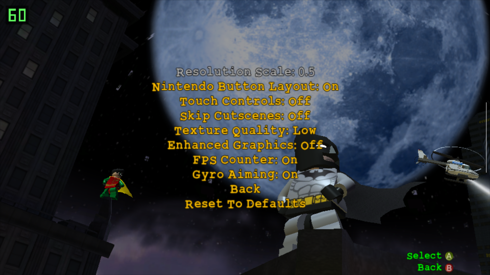

# LEGO Batman: The Videogame (PC) for Android

An unofficial "native" Android port of the PC version of *LEGO Batman: The Videogame*. It should run on any arm64 phone with Vulkan 1.1 and is tested on a Snapdragon device with an Adreno 610 GPU (Retroid Pocket Duo Lite, if anyone is curious).

This repository contains no game code or data. You need your own copy of the PC game, which is used as a basis for the recompilation. Personally, I used the Steam version.

Discord: http://discord.gg/df3cK2JCqs

Youtube link below:

[](https://www.youtube.com/embed/cPzNiIRWJdw)

## Functionality
- **Static recompilation.** This project is *not* a decompilation but a recompilation; Basically, it's just converting one type of code to another rather than re-creating the original source.
- **Graphics:** a patched [dxvk-native](https://github.com/Joshua-Ashton/dxvk-native) (native-1.9.2b) translates D3D9 to Vulkan 1.1. You must meet this requirement for the game to even launch, but most devices support it nowadays.
- **Platform:** SDL2 2.30.9 is used for the the window, input, audio and the Android activity. There is an optional on-screen overlay for phones without a controller that can be adjusted from the in-game menu.

## Port settings

In-game, under Options > **Video and Port Settings**:
- **Resolution Scale** (0.2 to 1.0): renders at a reduced screen resolution and stretches the image to fill the screen.
- **Nintendo Button Layout**: swaps A/B and X/Y on physical controllers.
- **Touch Controls**: show or hide the on-screen buttons.
- **Skip Cutscenes**: auto-skips as soon as loading is done.
- **FPS Counter**: show or hide the FPS counter (top left of screen).
- **Gyro Aiming**: toggles the ability to aim batarangs/targeted attacks with your device's gyroscope.

# Instructions

## Game files you need

Everything comes from your own PC install of *LEGO Batman: The Videogame* (2008).

| For building on PC | For playing on Android
| :------------------ | -------------------:
| LEGOBatman.exe | LEGOBatman.exe
| binkw32.dll | binkw32.dll
| GameIcon.ico | GameIcon.ico
| d3dx9_35.dll (32-bit) | d3dx9_35.dll (32-bit)
|| GAME.DAT  
||HERO1.DAT  
||HERO2.DAT  
||HERO3.DAT  
||VILLAIN1.DAT  
||VILLAIN2.DAT  
||VILLAIN3.DAT
||Audio/
||Movies/

#### Which executable?

- `LEGOBatman.exe` SHA-1 starts with `ed6c37c5`. Steam release (`testapp.exe`, 2008-09-05) with its SteamStub DRM removed by [Steamless](https://github.com/atom0s/Steamless).
- Check yours with `certutil -hashfile LEGOBatman.exe SHA1` (Windows) or `sha1sum LEGOBatman.exe`.
- Other releases (retail disc, other patches) have different code and are untested. Discovery and lifting will should on them, but the hooks in `runtime/` use fixed addresses (menu, options and input functions) that won't match.

See 3. Installing for instructions.

## 1. Building

The build has two stages:
1. Generate `gen/` from your game files. This is slow, runs once, and must be redone only when `tools/lift.py` changes.
2. Build the APK with Gradle, the Android NDK and CMake.

Linux (or WSL) is the easiest host for stage 1. Stage 2 works on Windows, Linux and macOS.

### 1.1 Generate the recompiled code

Requirements: Python 3.10+, plus `pip install capstone==5.0.9 pefile==2024.8.26`. `unicorn==2.0.1.post1` is only needed for `tools/difftest.py`, the lifter self-test.

Put your files (see above) in a folder, called `GAME` here, then run from the repository root:

```sh
tools/regen_gen.sh GAME
```

The script runs discovery and lifting for the three modules. Any functions the port replaces with host code are renamed `f_<addr>_guest` automatically, via `HOST_OVERRIDES` in `tools/lift.py`, so no manual edits are needed:

| Module | Load address | Output |
|---|---|---|
| `LEGOBatman.exe` | its own (0x400000) | `gen/exe_00.c` … `exe_63.c`, `exe_table.c`, `funcs_exe.h` |
| `d3dx9_35.dll` | 0x08000000 | `gen/d3dx9_*.c` |
| `binkw32.dll` | 0x09000000 | `gen/bink_*.c` |

Discovery of `d3dx9_35.dll` takes about an hour. The generated C is around 120 MB.

### 1.2.1 Build the APK

Requirements:
- JDK 17 or newer (Android Studio's bundled JBR works).
- Android SDK Platform 34, Build-Tools 34, CMake 3.22.1.
- NDK r27 or newer (built with 29.0.14206865).

Install them with Android Studio's SDK Manager, or from the command line:

```sh
sdkmanager "platforms;android-34" "build-tools;34.0.0" "cmake;3.22.1" "ndk;29.0.14206865"
```

Optionally install the real launcher icon from your copy: `python3 tools/make_icon.py GAME/GameIcon.ico`.

Then build:

```sh
cd android
# Linux/macOS
./gradlew assembleDebug -PndkVersion=29.0.14206865
# Windows
gradlew.bat assembleDebug "-PndkVersion=29.0.14206865"
```

The APK is written to `android/app/build/outputs/apk/debug/app-debug.apk`.

- The first build takes 10 to 40 minutes. Each recompiled file needs 1 to 2 GB of RAM to compile, so parallel compiles are capped with `LB_GEN_JOBS` (default 3). With more RAM, raise it in `android/app/build.gradle` by adding `"-DLB_GEN_JOBS=6"` to the cmake `arguments`.
- `debug` builds compile the native code with `-O3` anyway (`CMAKE_BUILD_TYPE=Release`). A real debug build is too slow to play.
- If you apply a patch from an archive, `touch` the extracted files. Archives keep old timestamps, and Ninja will otherwise skip recompiling them.

### 1.2.2 Desktop build (Linux, for testing)
The `Makefile` builds `build/lb`, a Linux x86-64 binary of the same port, which is useful for debugging with a desktop GPU. It needs clang, SDL2 development files, and a dxvk-native build: `make DXVK=/path/to/dxvk-native -j3`. Run it as `build/lb GAME_DIR SAVE_DIR`.

Useful environment variables:
| Variable | Effect |
|---|---|
| `LB_TOUCH=1` | Enables the touch overlay and the phone settings on desktop (mouse = touch). |
| `LB_LOG=n` | Log level. |
| `LB_KEYS`, `LB_KEYFIFO`, `LB_PADONLY=1` | Scripted input for automated tests. |
| `LB_D3DTRACE=from:to` | Logs D3D9 calls for those frames. |
| `LB_BCEMU=1` | Decodes DXT/BC textures on the CPU. |

## 3. Installing

Requirements: an arm64 Android phone with Android 9 or newer and Vulkan 1.1 (most Snapdragon 6xx/7xx/8xx devices from 2018 on) and about 2.5 GB of free space.

1. **Install the APK.** Copy it to the phone and open it, allowing "Install unknown apps" for your file manager or browser, or use `adb install -r LegoBatman-<version>.apk`. Newer versions install over older ones; only 0.1 to 0.1.1 needs an uninstall first.
2. **Start the app once.** It creates its folders and exits or shows an error because no game files are there yet.
3. **Copy the game files** listed above into
   `Internal storage/Android/data/com.tj.legobatman/files/game/`.
   - From a PC: connect by USB (File transfer mode) and copy them in, or run `adb push <your install>/. /sdcard/Android/data/com.tj.legobatman/files/game/`.
   - On Android 11+, most phone file managers cannot open `Android/data`. Use a PC, or a file manager with that access.
4. **Start the app.** Self explanatory.

## Controls
- Bluetooth, USB, and integrated controllers should work fine (Xbox layout by default; see Nintendo Button Layout).
- The touch overlay shows a stick, A/B/X/Y, shoulders, Start and Back.

## Troubleshooting
`Android/data/com.tj.legobatman/files/log.txt` is rewritten on every launch, so please attach it if reporting a problem.


## Documentation
- [CHANGELOG.md](CHANGELOG.md) for version history.

## Legal
LEGO, Batman and all related names and assets belong to their respective owners. This project is not affiliated with or endorsed by them. Do not redistribute anything produced from the game or game files. Third-party code keeps its own licenses: SDL2 (zlib) in `android/app/jni/SDL2`, dxvk-native (zlib) in `android/app/jni/dxvk`.
